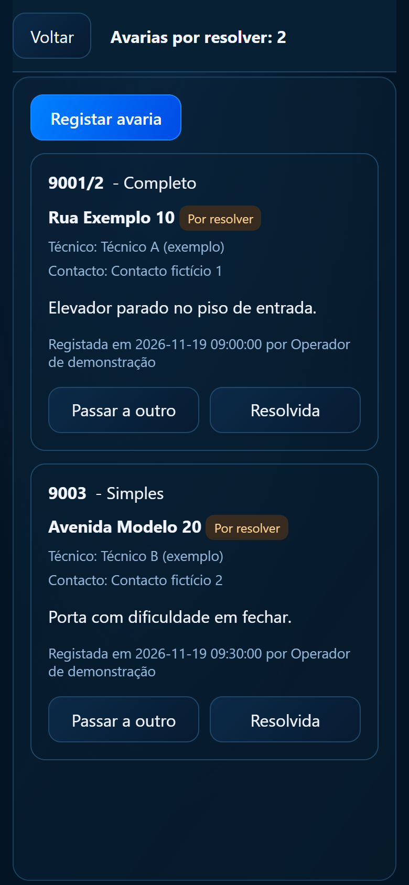
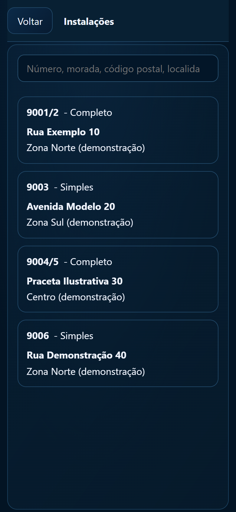
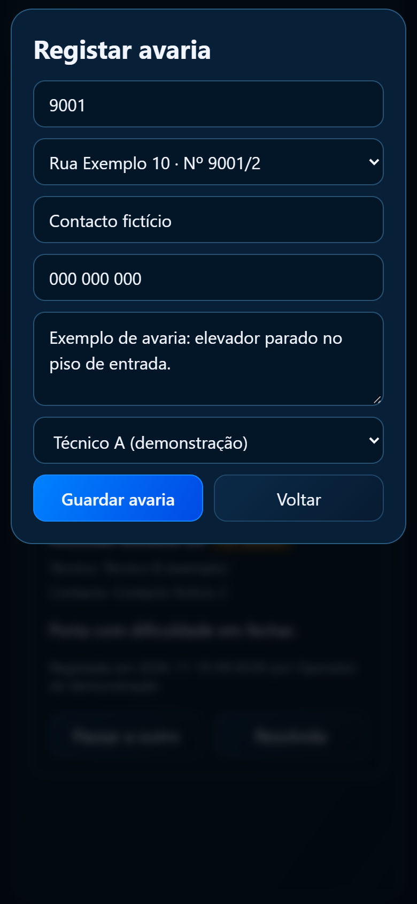
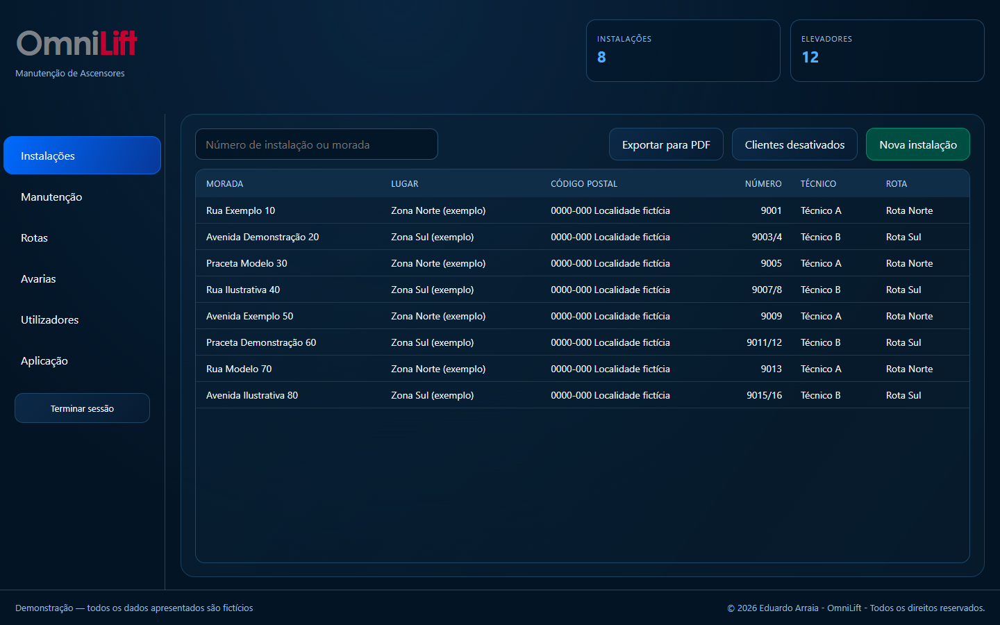

# OmniLift app

**Gestão de manutenção de ascensores, instalações e avarias.**

A OmniLift liga o trabalho dos técnicos no terreno à consola de administração. A aplicação para telemóvel permite consultar instalações, registar manutenções e acompanhar avarias, utilizando os dados do servidor central.

  

*Ecrã demonstrativo da aplicação. O nome apresentado é fictício; não são mostrados dados de clientes.*

## Manutenções, avarias e instalações no telemóvel

| Manutenções | Avarias | Instalações |
| :---: | :---: | :---: |
|  |  |  |

*Ecrãs demonstrativos com dados inteiramente fictícios: moradas, instalações, contratos, lugares, técnicos, contactos, ocorrências e datas. Nenhum registo real foi utilizado.*

Da esquerda para a direita: o técnico consulta e confirma as manutenções pendentes; acompanha as avarias e o respetivo responsável; e pesquisa instalações para consultar a sua ficha.

## Ficha, e-mail e registo de avaria no telemóvel

| Ficha da instalação | Envio de e-mail | Registo de avaria |
| :---: | :---: | :---: |
|  |  |  |

A ficha apresenta os dados da instalação apenas para consulta: número e contrato, morada e lugar, código postal e localidade, e-mail, acesso ao edifício, chave da casa das máquinas, processos DGEG e observações. Os botões **E-mail** e **Navegação** permitem preparar o contacto com o cliente e abrir o percurso.

No envio de e-mail, o técnico pode rever o destinatário, o assunto e a mensagem antes de carregar em **Confirmar e enviar**. O envio é feito pelo servidor, com cópia para o escritório.

No registo de avaria, o técnico procura a instalação, indica quem telefonou e o contacto, descreve a avaria e escolhe o técnico responsável antes de carregar em **Guardar avaria**.

*Todos os dados destas imagens são fictícios, incluindo moradas, contactos, códigos de acesso, chaves, processos DGEG e técnicos. Não foi utilizada uma ficha real, registada qualquer avaria ou enviado qualquer e-mail ou notificação para criar estas imagens.*

## Consola de administração

*Imagem demonstrativa: todas as moradas, números, localidades, técnicos, rotas e contagens apresentados são fictícios. Não contém dados reais de clientes.*

## Como funciona

A OmniLift reúne a consulta de instalações, as manutenções, as avarias e as anotações. As funções disponíveis dependem do teu perfil e dos acessos concedidos.

### Acesso

O equipamento é autorizado antes da primeira utilização. Entra com o teu próprio acesso para consultar as funções disponíveis. Ao terminar sessão, é pedida confirmação. Se mudares de navegador ou apagares os dados da aplicação, pode ser necessária uma nova autorização.

### Manutenções

O técnico vê as manutenções por concluir das instalações que lhe estão atribuídas, com ou sem rota. O título indica quantas instalações faltam concluir: uma instalação pode incluir mais de um elevador. Toca em «Feito» e confirma a manutenção, com a morada, o lugar e a data e hora preenchidas automaticamente. No início de cada mês começa um novo ciclo e o histórico fica guardado.

### Anotações

O botão «Anotações» está disponível na Manutenção, na ficha da instalação e nas avarias. Podes criar uma nota para qualquer instalação. Se a manutenção do mês estiver por fazer, a nota fica nesse mês; se já estiver feita, fica para o seguinte. Em «Ver», o técnico consulta as notas das suas instalações e o Atendimento pode consultar todas, sem selecionar um mês. Cada nota permite editar ou apagar, com confirmação antes de apagar. Ao concluir a manutenção, são eliminadas as notas dessa instalação relativas ao mês concluído; as dos meses seguintes são mantidas.

### Instalações e navegação

Em «Instalações», podes consultar todas as instalações ativas. A pesquisa encontra número de instalação, morada, código postal, localidade e lugar, mesmo sem acentos. Um número como 2033/4 pode ser encontrado por 2033 ou 2034. Toca na área da instalação para abrir a ficha de consulta.

O botão «Navegação» usa a morada, o código postal e a localidade para abrir o percurso no mapa. As coordenadas guardadas são usadas para ordenar as instalações por proximidade, não como destino deste botão.

### Localização

Nos equipamentos dos técnicos, Manutenção e Instalações apresentam primeiro as seis instalações mais próximas com coordenadas disponíveis e depois as restantes. A localização é atualizada enquanto a página está aberta e a aplicação está visível. A tua posição é usada apenas no equipamento: não é enviada ao servidor nem guardada. O acompanhamento para ao sair destas páginas ou quando a aplicação deixa de estar visível. O perfil Atendimento não pede localização.

### Avarias e notificações

Podes registar uma avaria em qualquer instalação e escolher o técnico responsável. Os utilizadores com acesso a Avarias podem consultar os registos; o aviso é dirigido ao técnico escolhido. As avarias por resolver atribuídas ao técnico aparecem numa janela de aviso ao entrar na aplicação. A visualização fica registada com data e hora.

«Passar a outro» permite escolher outro técnico e regista a passagem. Em «Resolvida», escolhes se queres enviar e-mail e descreves o trabalho realizado. A resolução requer confirmação. As avarias por resolver transitam para o mês seguinte.

Ativa as notificações em cada equipamento para receber avisos mesmo com a aplicação fechada. A autorização depende do telemóvel. No iPhone e iPad, abre a aplicação pelo ícone adicionado ao ecrã principal. Quando a aplicação está em segundo plano, o sistema pode apresentar uma notificação; a janela interna aparece quando a aplicação está visível.

### E-mail da instalação

O botão «E-mail» permite rever a mensagem antes de confirmar o envio. O remetente é geral@omnilift.pt; os destinatários são os contactos da instalação, com cópia para o escritório. O assunto contém a morada e a localidade. Na resolução de uma avaria por e-mail, o texto da mensagem fica registado como trabalho realizado.

### Mensagem ao escritório

No ecrã inicial do telemóvel, «✉ Escritório» permite escolher uma instalação, enviar uma mensagem para geral@omnilift.pt e anexar várias fotografias. O assunto é «Mensagem Interna — Morada — Lugar». As imagens são comprimidas automaticamente para JPEG, até 800 píxeis no lado maior e com qualidade de 80%, sem alterar os originais. O limite é de 10 MB no total, depois da compressão. A janela mostra a quantidade de imagens e o tamanho total.

Ao carregar em «Enviar», a janela fecha e podes continuar a usar a aplicação enquanto o envio decorre. Se ocorrer um erro, volta a abrir com o texto e as imagens preservados. Mantém a aplicação aberta até o envio terminar. A mensagem é entregue por e-mail ao escritório; o texto e as fotografias não ficam guardados para consulta na aplicação.

### Ligação ao servidor

É necessária ligação à Internet para consultar dados atualizados, guardar alterações e enviar mensagens. Os códigos de acesso ao edifício e as chaves não ficam disponíveis para consulta sem ligação.

## Utilização

A OmniLift é uma aplicação web com apresentação adaptada ao telemóvel e à consola de administração. O acesso operacional é reservado a utilizadores autorizados. É necessária ligação ao servidor para consultar dados atualizados e guardar alterações.

## Sobre este repositório

Este repositório contém apenas a apresentação da OmniLift e imagens demonstrativas. Não disponibiliza o software, o código-fonte, a base de dados, credenciais ou dados operacionais de clientes.

© 2026 Eduardo Arraia - OmniLift - Todos os direitos reservados.
